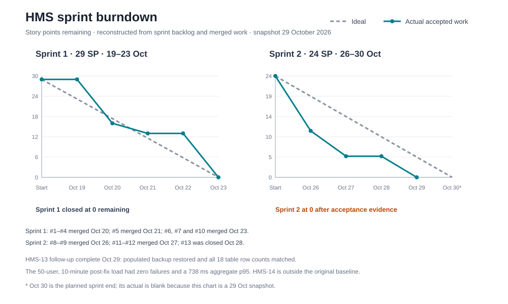

# Sprint Burndown

The chart uses story-point estimates from `HMS_Part1_Sprint_Backlog.docx` and the repository's dated merged-PR history as an acceptance proxy. It is reconstructed from recorded artifacts, not a contemporaneous daily board export. Actual points fall only when corresponding work is evidenced as complete in a merged change. Sprint 2 is still in progress on 29 October 2026: HMS-13 retains 5 points because its acceptance checks are partially demonstrated. The 30 October actual is intentionally blank.

Source values and rationale are in [`BURNDOWN_DATA.csv`](BURNDOWN_DATA.csv). The whole-project submission checklist is in [`SUBMISSION_CHECKLIST.md`](SUBMISSION_CHECKLIST.md).
